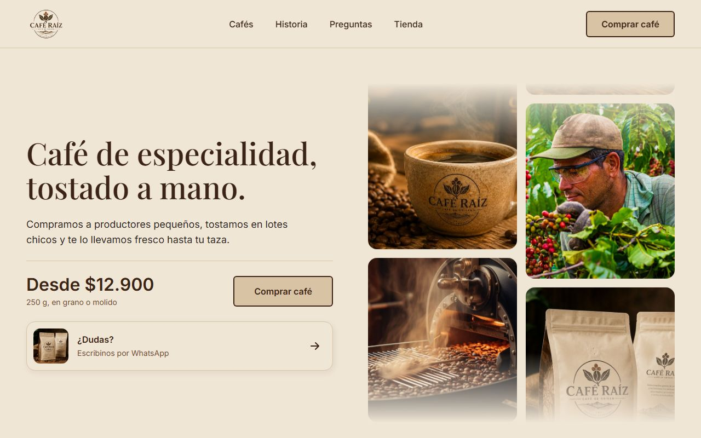

# Café Raíz

Landing y tienda de una marca de café de especialidad y tostado artesanal. Es un caso ficticio que armé como práctica del módulo de Claude Design de la comunidad Triple A, en 2026. Lo trabajé como un encargo real: ordené lo que pedía el cliente, armé un Design System con los datos de su marca, diseñé en Claude Design, tomé las decisiones de estructura y de tono, y dirigí a Claude Code, que pasó el diseño a código.

## Problema que resuelve

Quien llega por primera vez a una marca de café de especialidad no sabe qué elegir ni si puede confiar. La web tiene que contar el origen en pocas líneas, mostrar cada café con su precio y llevar a la compra sin vueltas.

La consigna pedía una landing con un botón de compra que llevara a una tienda. Fui más allá del pedido y armé la tienda: quería experimentar cómo se desarrolla un pequeño e-commerce. El desafío de esa parte fue que se entienda en segundos cómo comprar sin cobrar en la web: se arma el pedido y se manda por WhatsApp.

## Demo

https://cafe-raiz-especialidad.vercel.app

Los datos son de ejemplo: productores, precios, envíos, WhatsApp, Instagram y la feria no existen, y nada se vende ni se entrega. El mapa marca un punto de Palermo que es solo genérico.

Las fotos de las bolsas están generadas con IA a partir de la foto del packaging original que vino con la práctica. Los 4 packs usan por ahora una foto genérica.

## Tecnologías

- HTML: estructura de las dos páginas, `index.html` (landing) y `tienda.html`.
- CSS: estilos y diseño adaptable a celular, sin framework. Los 6 colores y las 2 tipografías de la marca están definidos como variables en `styles.css`, y la tienda suma solo lo propio en `tienda.css`.
- JavaScript sin build ni dependencias: carrusel, menú del celular, filtros, ventana de detalle, pedido y mensaje de WhatsApp.
- `localStorage`: guarda el pedido para que no se pierda al recargar.
- Google Fonts (Playfair Display e Inter): tipografías de la marca.
- Google Maps embebido: mapa de la feria en el cierre de la landing.
- Vercel: publica la web desde este repo, con `cafe-raiz` como Root Directory.
- Claude Design: donde diseñé la landing y la tienda, a partir del Design System de la marca.
- Claude Code: escribió el código a partir del diseño y de las decisiones que fui definiendo.

## Cómo funciona

Son dos páginas estáticas que comparten `styles.css`. No hay build ni nada que instalar. El catálogo (12 cafés y 4 packs) es un arreglo en `tienda.js`, y desde ahí se arman las tarjetas, los filtros y el pedido. El botón "Enviar pedido por WhatsApp" abre `wa.me` con el detalle escrito; el número es de ejemplo.

Las decisiones que tomé y por qué:

- **Un Design System con los datos de la marca, antes de diseñar.** Cargué la paleta, las tipografías y el tono del manual para diseñar en Claude Design siempre desde la misma base. Por eso la landing y la tienda se ven como la misma marca.
- **Una plantilla elegida con un propósito.** Usé E-commerce Website porque su estructura (hero con una sola acción, productos con precio, origen, preguntas frecuentes y cierre con compra) es lo que necesitaba este caso. Tomé la estructura y no el estilo: el fondo claro y los colores salen del manual.
- **Todo sale del Design System.** Los estilos y la estructura de las dos páginas siguen el Design System de la marca: los 6 colores del manual (al medir la tienda armada encontré 3 que no eran de la marca y los reemplacé por Leche y transparencias de Crema), Playfair Display en los títulos e Inter en los textos, y los mismos botones, tarjetas y rótulos en la landing y en la tienda.
- **Tienda en una sola página, sin pestañas.** Los packs van primero y los cafés después, con filtros por tueste y por origen. El detalle de cada café abre en una ventana que se cierra con Esc.
- **Sin pasarela de pagos ni servidor.** Es lo mínimo para armar un pedido legible. La tienda lo aclara desde la entrada ("Acá no se cobra") y en las preguntas de compra para que nadie busque un botón de pagar que no existe. Cobrar por la web quedaría para una segunda etapa.
- **El botón de enviar se bloquea hasta que haya un producto y un nombre.** Antes de mandar, hay un botón para ver cómo llega el mensaje.
- **Tono de la marca en cada texto.** Voseo, cálido y sin jerga, como pide el manual. Evité las palabras que el manual rechaza, como "organoléptico" o "premium".
- **Pensada para el celular.** Todo lo tocable mide al menos 44 px, los filtros que no entran se deslizan con una flecha y en el pack destacado el botón de agregar va debajo de la cantidad.
- **Carga más liviana, a partir de Lighthouse.** Mostró que la imagen principal se cargaba tarde, que las fuentes de Google frenaban la primera pantalla y que los packs se armaban sin espacio reservado. Ahora la imagen principal carga primero, las fuentes no bloquean y el espacio de packs y cafés queda reservado. En celular, la tienda pasó de 68 a 93 y la landing de 88 a 99 en Performance.
- **Vista previa al compartir el link y favicon.** Para que se vea bien en WhatsApp. El favicon es el isotipo sobre el color Espresso.

## Cómo correrlo

Se ve en el link publicado: https://cafe-raiz-especialidad.vercel.app.

## Qué aprendí y qué mejoraría

**Qué aprendí**

- **Armar un Design System con los datos de la marca** (colores, tipografías y tono del manual) y diseñar en Claude Design desde esa misma base, para que la landing y la tienda sean coherentes.
- **Usar las plantillas con un propósito.** Elegí la de E-commerce Website y justifiqué por qué: de ella tomé la estructura y no el estilo, que adapté al fondo claro y a la paleta del manual. No la elegí solo porque me gustara.
- **Ir más allá de la consigna, a propósito.** Armé una tienda aparte aunque excedía el alcance, porque me tomo estos proyectos como un trabajo y quería experimentar cómo desarrollar un pequeño e-commerce.
- **Lighthouse muestra información extra que no se ve a simple vista**, como imágenes importantes con carga diferida, fuentes que bloquean la primera pantalla o saltos de diseño.
- **Aunque los datos sean inventados, se mantiene lo que quiere el cliente:** la esencia de la marca, lo que busca y lo que entrega. Por eso separé lo que viene del manual de lo que inventé y lo marqué como ejemplo.

**Qué mejoraría**

- Generar fotos propias para los 4 packs y revisar las etiquetas de las bolsas.
- Cambiar el mapa embebido por uno que se cargue solo al tocarlo. Es lo que baja las Buenas prácticas de la landing a 77: Lighthouse detecta 32 cookies de terceros de Google Maps.
- Reemplazar los datos de ejemplo (WhatsApp, Instagram, feria) por los reales si el negocio fuera de verdad.
- Sumar pagos en línea y control de stock.
