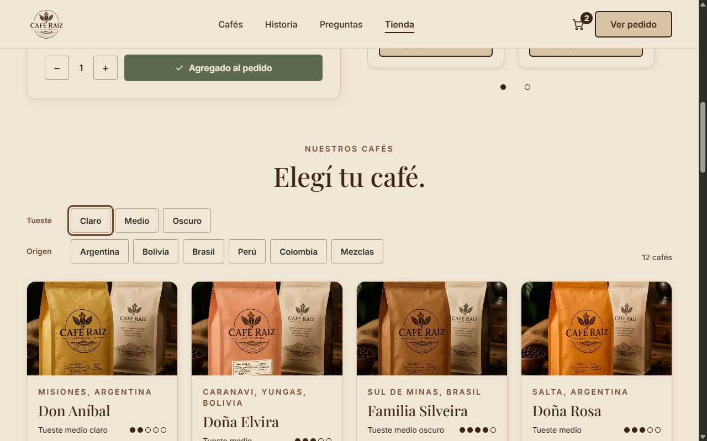
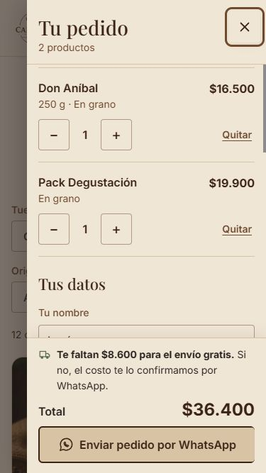

# Café Raíz

Landing y tienda de un café de especialidad ficticio, diseñadas en Claude Design a partir de un manual de marca y llevadas a HTML, CSS y JavaScript sin librerías.

**Web:** https://cafe-raiz-especialidad.vercel.app

> **Es un caso ficticio de práctica.** Todos los datos son de ejemplo: productores, precios, envíos, WhatsApp, Instagram y la feria. Nada de esto se vende ni se entrega.

## Problema que resuelve

Quien llega por primera vez a una marca de café de especialidad no sabe qué elegir ni si puede confiar. La web tiene que contar el origen en pocas líneas, mostrar cada café con su precio y llevar a la compra sin vueltas.

- **Landing** (`index.html`): una acción principal, cafés con origen, notas y precio, historia, preguntas frecuentes y cierre con compra.
- **Tienda** (`tienda.html`): packs y 12 cafés con filtros por tueste y origen, ficha de detalle, y un pedido que se envía armado por WhatsApp. No cobra: el pago y el envío se coordinan por chat.

## Demo

| Landing (escritorio) | Tienda (escritorio) | Pedido (celular) |
|---|---|---|
|  |  |  |

## Tecnologías

- HTML, CSS y JavaScript sin dependencias ni paso de compilación.
- Playfair Display e Inter (Google Fonts).
- Mapa de Google Maps embebido en el cierre de la landing.
- Vercel para el deploy (Root Directory `cafe-raiz`).

## Cómo funciona

- `styles.css` define los tokens de marca (6 colores, 2 tipografías) y los estilos que comparten la landing y la tienda.
- `tienda.css` y `tienda.js` agregan solo lo propio de la tienda. El catálogo es un arreglo en `tienda.js`; las tarjetas, los filtros y el pedido se arman desde ahí.
- El pedido se guarda en `localStorage` y el botón abre `wa.me` con el detalle escrito. El número es de ejemplo.

**Las decisiones que tomé y por qué:**

- Un solo botón principal por pantalla y los precios a la vista, para que se entienda en segundos cómo comprar.
- Solo los 6 colores del manual. Los estados (campo, opción elegida, botón bloqueado) usan Leche o transparencias de Crema en vez de colores nuevos.
- Los títulos van en Playfair Display y los textos en Inter; no hay serif en párrafos largos.
- La tienda es una sola página (packs, filtros y cafés), sin pestañas, y reutiliza los componentes de la landing para que se vea la misma marca.
- Sin pasarela de pagos ni servidor: es lo mínimo para armar un pedido legible. Cobrar por la web quedaría para una segunda etapa.
- Todo texto de ejemplo está marcado como tal; ningún dato inventado se presenta como real.

## Datos de ejemplo y límites

- **Inventado:** los productores (Don Aníbal, Doña Elvira, etc.), los precios, las condiciones de envío (gratis desde $45.000), el número de WhatsApp y el Instagram.
- **Feria:** "Plaza Armenia, Palermo, sábados de 10 a 18 h" es inventada, pero el mapa apunta a un lugar real (Armenia y Costa Rica, Palermo).
- **Fotos:** las bolsas son maquetas generadas con IA, no productos reales. Las etiquetas pueden traer defectos (corchetes, listas numeradas en algún texto). Las franjas de color de cada bolsa no son del manual y viven solo dentro de las fotos.
- **Packs:** los 4 packs usan por ahora la foto genérica `packaging.jpg`; falta su foto propia.
- **Imágenes del caso** (hero, tostadora, trabajador, granos): se usan tal como las entregó la consigna; su origen no está verificado.
- **Terceros:** Google Fonts y Google Maps se cargan desde servidores de Google al abrir la página.

## Cómo correrlo

No hay dependencias. Desde esta carpeta:

```
python -m http.server 8770
```

y abrí http://localhost:8770 (landing) o http://localhost:8770/tienda.html.

## Verificación

Medido en Chrome a 1280 y 375 px: sin scroll horizontal, sin errores de consola ni recursos rotos, solo los 6 colores del manual y fuentes aplicadas, filtros, ventana de detalle (cierra con Esc) y pedido funcionando. Todavía falta medir con Lighthouse en celular y probar la vista previa en WhatsApp.

## Qué mejoraría

- Fotos propias para los 4 packs y revisar las etiquetas de las bolsas.
- Medir Lighthouse en celular sobre el link real y ajustar lo que salga flojo.
- Actualizar `og:url` y el canonical si cambia el dominio.
- Si el negocio fuera real: pagos en línea y stock.

## Qué aprendí

_Pendiente: lo completa la autora con sus propias palabras._
