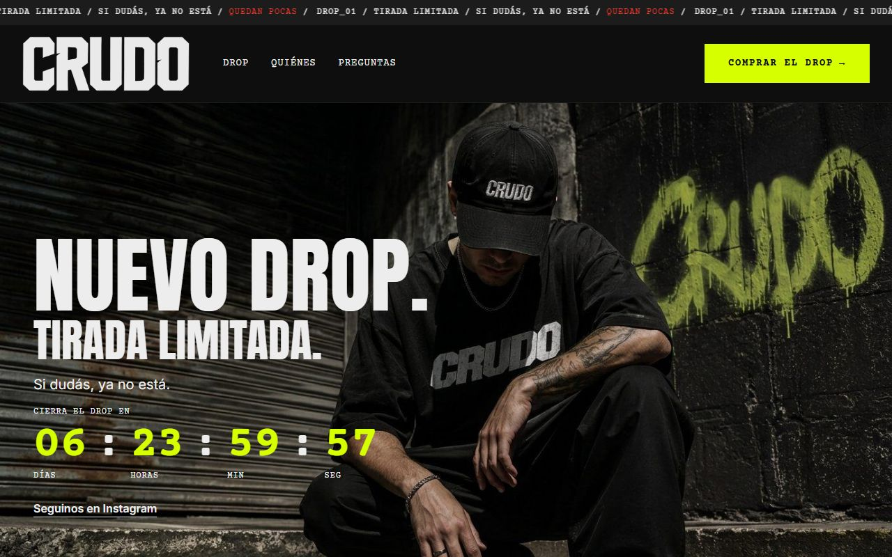
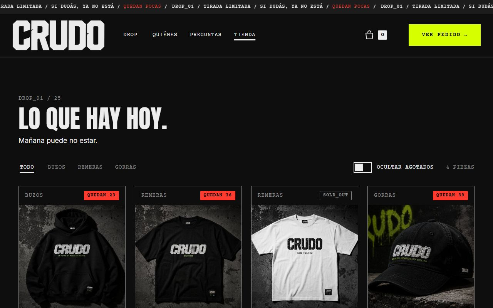
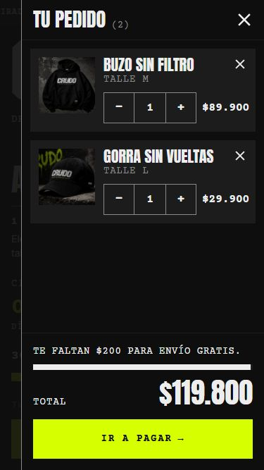

# CRUDO

Landing y tienda de una marca de ropa urbana de edición limitada. Es un caso ficticio que armé como proyecto final del módulo de Claude Design de la comunidad Triple A, en 2026. A diferencia de Café Raíz, acá no había plantilla: partí de un manual de marca y de una hoja en blanco. Lo trabajé como un encargo real: ordené lo que pedía el cliente, armé un Design System con los datos de su marca, diseñé en Claude Design, tomé las decisiones de estructura y de tono, y dirigí a Claude Code, que pasó el diseño a código.

## Problema que resuelve

CRUDO vendía por Instagram y avisaba los drops por ahí. Quería una web propia donde se sienta la energía de la marca apenas se entra, con las prendas como protagonistas y con la urgencia de "lo que hay hoy puede no estar mañana".

El público tiene entre 18 y 30 años, entra desde el celular y scrollea rápido. El desafío fue darle estímulo constante (movimiento, números que cambian, fotos grandes) sin caer en el exceso, y mantener el tono de calle en cada texto.

La consigna pedía una landing con un link a la tienda. Fui más allá y armé también la tienda: catálogo, filtros, ventana de detalle, pedido y un pago simulado.

## Demo

https://crudo-ropa-urbana.vercel.app







Los datos son de ejemplo: la marca, el Instagram (`@crudo.ejemplo`), los precios, el stock, las tiradas, el archivo de drops, el envío ($6.500, gratis desde $120.000), los plazos y las condiciones de cambio no existen, y nada se vende ni se entrega. El pago es una simulación: no se pide ningún dato y no se cobra ni se guarda nada.

Las fotos de la remera negra y de la remera hueso están generadas con IA (Gemini), a partir del buzo y del logo oficiales que vinieron con la práctica. El resto de las fotos son las del material original.

## Tecnologías

- HTML: estructura de las dos páginas, `index.html` (landing) y `tienda.html`. Cada una lleva su CSS y su JavaScript adentro.
- CSS: estilos y diseño adaptable a celular, sin framework. Los 6 colores y las 3 tipografías de la marca están definidos como variables.
- JavaScript sin build ni dependencias: cuenta regresiva, filtros, ventana de detalle, panel del pedido, stock y pago simulado.
- `localStorage`: guarda la fecha de la primera visita para que la cuenta regresiva siga en pie al recargar y se comparta entre la landing y la tienda.
- Google Fonts (Anton, Inter y Courier Prime): tipografías de la marca.
- Vercel: publica la web desde este repo, con `caso-crudo` como Root Directory.
- Claude Design: donde diseñé las dos páginas, a partir del Design System de la marca.
- Claude Code: escribió el código a partir del diseño y de las decisiones que fui definiendo.
- Gemini: generó las dos fotos de remeras que faltaban.

## Cómo funciona

Son dos páginas estáticas, sin build ni nada que instalar, con las imágenes en `assets/`. El catálogo (4 prendas, con su stock por talle) es un arreglo dentro de `tienda.html`, y desde ahí se arman las tarjetas, los filtros y el pedido. Al "pagar", el stock baja en la página y la barra de prendas vendidas se recalcula; al recargar vuelve todo al estado inicial.

Las decisiones que tomé y por qué:

- **Estructura propia, sin plantilla.** La consigna lo pedía. Armé 9 bloques con su orden y su jerarquía: cinta y encabezado, hero con cuenta regresiva, el drop, la calle, quiénes somos, archivo de drops agotados, preguntas, cierre y pie. Pensé el orden para que se entienda rápido qué hay hoy, cuánto queda, cuándo cierra y cómo se compra.
- **Referencias como norte, no como copia.** Tomé de Supreme la idea de una acción única y el "agotado" visible como parte del diseño, y de Palace las fotos grandes y el aire. La paleta, las tipografías y los menús salen solo del manual.
- **Estímulo sin exceso.** Pensé la web para alguien que scrollea rápido: una cinta en movimiento, una cuenta regresiva, una barra de tirada y una aparición suave de los bloques. Todo se apaga con `prefers-reduced-motion`.
- **Colores con uso medido.** El volt aparece solo en el botón principal, la cuenta regresiva y la barra de vendidas. El rojo, solo en el stock y en "QUEDAN POCAS". Lo medí en el sitio publicado: no hay colores fuera de los 6 del manual.
- **Cuenta regresiva de ejemplo.** El drop cierra 7 días después de la primera visita, y al llegar a cero vuelve a empezar con 7 días. El código lo aclara en un comentario. La landing y la tienda comparten la misma fecha.
- **Una sola web en dos páginas.** La tienda usa el mismo encabezado, cinta, paleta, tipografías y pie que la landing. Pasé una revisión de textos sobre las dos para que digan lo mismo: el costo del envío y los pasos de compra coinciden.
- **Pago simulado hasta "Pago realizado".** En el prompt había pedido pasos de datos y de tarjeta, pero decidí dejarlo hasta ahí: el recorrido se entiende igual y no hay que pedir datos. La tienda lo aclara desde la entrada y en las preguntas.
- **Una frase propia en vez de la del manual.** Cambié "Cuando vuela, voló", que venía del manual, por "Si dudás, ya no está." en el hero, la cinta y la descripción al compartir el link. Le habla directo a quien está por comprar.
- **Pensada para el celular.** Todo lo tocable mide al menos 44 px. Las etiquetas chicas (stock, cuenta regresiva, cinta) quedan en 12 px por decisión mía, a diferencia de Café Raíz, donde el mínimo es 14 px.
- **Carga más liviana.** Optimicé las imágenes (de 1,59 MB a 1,28 MB en total, y bastante menos en celular de la landing, porque las prendas tienen una versión de 560 px y los logos pasaron de 170 y 122 KB a 6 y 11 KB).
- **Vista previa al compartir el link y favicon.** La imagen sale de un recorte del hero y el favicon es la C del logo en hueso sobre negro.

Medí con Lighthouse, en modo celular y sobre los links publicados:

| Página | Performance | Accesibilidad | Buenas prácticas | SEO |
|---|---|---|---|---|
| Landing | 88 | 100 | 100 | 100 (92 si se mide `/index.html`) |
| Tienda | 86 | 100 | 100 | 100 |

El SEO de la landing baja a 92 al medir `/index.html` porque el canonical apunta a la raíz; midiendo la raíz da 100. En Performance, el primer dibujado y la imagen principal rondan los 3 segundos: las fuentes de Google frenan la primera pantalla. Decidí dejarlo así y lo anoto como mejora.

## Cómo correrlo

Se ve en el link publicado: https://crudo-ropa-urbana.vercel.app.

Para verlo en tu compu, desde la carpeta `caso-crudo`:

```
python -m http.server 8000
```

y abrí `http://localhost:8000`.

## Qué aprendí y qué mejoraría

**Qué aprendí**

- **Diseñar desde cero, sin plantilla.** Decidí yo la estructura y la jerarquía a partir del manual y de a quién le habla la web, en vez de adaptar algo ya armado.
- **Traducir la actitud de una marca en movimiento, con límites.** La cinta, la cuenta regresiva y la barra de tirada dan el estímulo que pide el público, y todo respeta `prefers-reduced-motion` y el rendimiento en celular.
- **Que landing y tienda sean una sola web.** El mismo encabezado, paleta, tipografías y cuenta regresiva en las dos, y textos revisados para que no se contradigan.

**Qué mejoraría**

- Cargar las fuentes de Google sin bloquear la primera pantalla, para bajar los 3 segundos de carga en celular.
- Sumar los pasos de datos y de pago a la tienda, con sus errores y estados.
- Reemplazar los datos de ejemplo (Instagram, precios, stock, envío) por los reales si el negocio fuera de verdad, y cobrar con una pasarela de pagos y un stock que se guarde.
